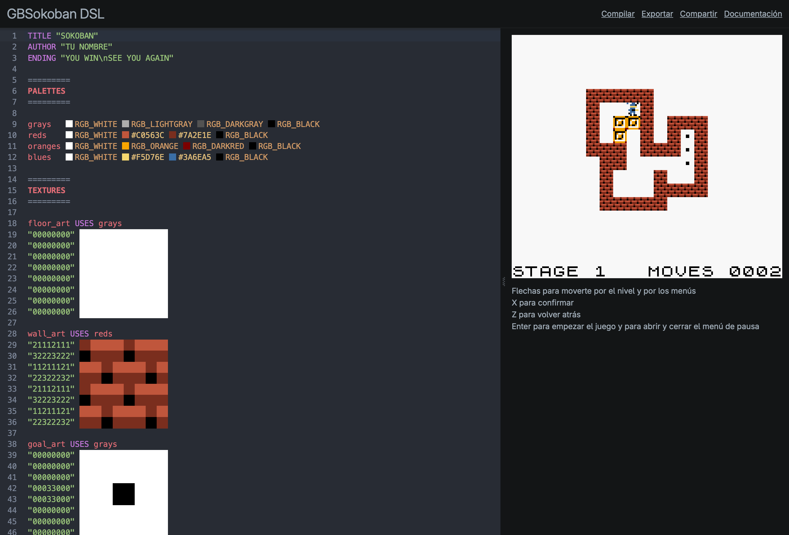

# GBSokoban DSL

GBSokoban es un lenguaje específico de dominio para crear juegos del género Sokoban para la Game Boy. A partir de un fichero `.gbsoko` se genera un proyecto en C con GBDK-2020 que se compila en una ROM `.gb` (o `.gbc` si el juego es a color). Está construido con Xtext y Xtend, e incluye ayudas a la edición como validadores, content assist y quick fixes.



## Instalación

```sh
git clone https://github.com/droditto/gbsokoban-dsl
cd gbsokoban-dsl
docker build -t gbsokoban .
docker run -d --name gbsokoban -p 3000:3000 -v gbsokoban-data:/app/web/data gbsokoban
```

## Documentación

En la [documentación](web/docs/src/SUMMARY.md) puedes encontrar todo lo que se puede hacer con el lenguaje.

## Desarrollo

Para modificar el editor web, se puede lanzar directamente desde el código fuente.

```sh
git clone https://github.com/droditto/gbsokoban-dsl
cd gbsokoban-dsl
./setup.sh
cd web
npm run dev
```

Para modificar el DSL, basta con importar en Eclipse los proyectos `com.drodo.gbsokoban`, `com.drodo.gbsokoban.ide` y `com.drodo.gbsokoban.ui`, ejecutar `GenerateGBSokoban.mwe2` como MWE2 Workflow y lanzar una instancia con Run As > Eclipse Application. Al guardar un `.gbsoko`, se generará un proyecto C/GBDK-2020 que se compila automáticamente con `make` si GBDK-2020 está instalado en `~/gbdk` o en la ruta que indique `GBDK_HOME`.
